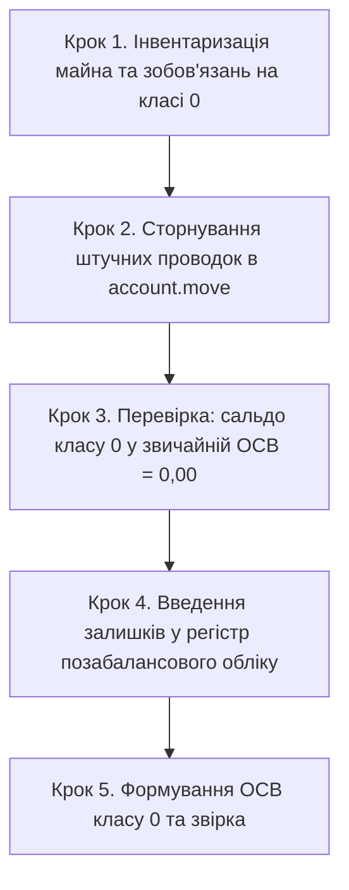

# HOWTO: Перехід на простий позабалансовий облік (клас 0) та сторнування штучних залишків

← [Назад до інструкцій](README.md) · [Бухгалтерський облік](accounting.md) · [Опис домену](../core_accounting.md)

> Ця інструкція призначена для головних бухгалтерів та обліковців комерційних і бюджетних установ,
> які переходять зі старої схеми «штучного подвійного запису» (пари `Дт 01 / Кт 09` або проведення через технічні рахунки `00`)
> на офіційний регістр позабалансового обліку `l10n_ua.offbalance.move` за простою (односторонньою) системою.

---

## 1. Чому потрібен перехід: законодавча та технічна база

Згідно з **Інструкцією про застосування Плану рахунків бухгалтерського обліку** (наказ Мінфіну України від 30.11.1999 № 291)
та **Порядком застосування Плану рахунків у державному секторі** (наказ Мінфіну від 29.12.2015 № 1219):

* Облік на рахунках класу 0 ведеться **за простою системою** — запис робиться лише за дебетом (надходження) або лише за кредитом (вибуття), **без кореспонденції з іншими рахунками**.
* Оскільки ядро Odoo вимагає балансу кожної проводки (`account.move._check_balanced`), раніше бухгалтери були вимушені робити штучні подвійні записи на кшталт `Дт 01 / Кт 09`.

### Недоліки старої схеми
1. **Викривлення Головної книги та ОСВ**: рахунки класу 0 штучно потрапляли в загальний дебетовий і кредитовий оборот підприємства, хоча вони не є активами чи капіталом підприємства.
2. **Ризик помилок у Балансі (Форма № 1)**: залишкові суми штучних кореспондентів могли випадково потрапляти до рядків звітності.
3. **Відсутність повноцінного кількісного обліку**: стандартні балансові рядки складно пов'язувати з кількістю орендованих площ, одиниць обладнання чи бланків.

У модулі `l10n_ua_account_base` реалізовано незалежний регістр позабалансового обліку:
* Документи: `l10n_ua.offbalance.move` (за простою системою).
* Рядки: `l10n_ua.offbalance.move.line` (із фіксацією кількості, контрагента, напряму Дт/Кт).
* Окрема звітність: **ОСВ по класу 0** (`l10n_ua.offbalance.osv`) із можливістю друку PDF у ландшафтній орієнтації.
* Бюджетна звітність: **Меморіальний ордер № 16 (МО-16)** за наказом Мінфіну № 755.

---

## 2. Покроковий процес міграції

### Крок 1. Інвентаризація залишків
Перед переходом складіть відомість фактичного майна, що перебуває на позабалансовому обліку на обрану дату (наприклад, `31.12.2025` або кінець звітного кварталу):
* **Рахунок 01**: орендовані приміщення, автомобілі, обладнання (найменування, площа/кількість, договірна вартість, орендодавець).
* **Рахунок 02**: активи на відповідальному зберіганні або переробці (номенклатура, кількість, вартість, поклажодавець).
* **Рахунок 08**: бланки суворого обліку (трудові книжки, атестати, дипломи — кількість штук, за наявності — номінальна вартість).

### Крок 2. Сторнування старих парних проводок в `account.move`
Щоб очистити балансові регістри від штучних проводок, створіть операцію сторнування або зворотного запису:

1. Перейдіть: **Бухоблік → Операції → Журнальні записи**.
2. Натисніть **Створити**.
3. Оберіть журнал: **Операції вручну** (General).
4. Дата: дата переходу (наприклад, `31.12.2025`).
5. У рядках додайте сторнуючі записи:
   * Якщо раніше було зроблено `Дт 01 100 000 / Кт 09 100 000`:
     * Рядок 1: Рахунок `01`, Кредит `100 000,00` (або Дебет `-100 000,00` з прапорцем Сторно).
     * Рядок 2: Рахунок `09`, Дебет `100 000,00` (або Кредит `-100 000,00` з прапорцем Сторно).
6. Натисніть **Провести**.

> [!IMPORTANT]
> **Контрольна перевірка**: сформуйте стандартну **Оборотно-сальдову відомість** (**Бухоблік → Звітність → Бухгалтерські звіти → Оборотно-сальдова відомість**). Переконайтеся, що кінцеве сальдо за всіма субрахунками класу 0 дорівнює **0,00**.

### Крок 3. Внесення початкових залишків у позабалансовий регістр
Тепер внесіть реальні об'єкти до нового одностороннього регістру:

1. Перейдіть: **Бухоблік → Позабалансовий облік → Документи позабалансового обліку**.
2. Натисніть **Створити**.
3. Заповніть заголовок:
   * **Дата**: дата переходу (наприклад, `01.01.2026`).
   * **Документ-підстава**: «Введення залишків позабалансового обліку станом на 01.01.2026».
4. У вкладці **Рядки** додайте позиції:
   * **Рахунок**: `01 Орендовані необоротні активи`.
   * **Напрям**: `Надходження (Дебет)`.
   * **Контрагент**: оберіть орендодавця (наприклад, `ПрАТ "Орендодавець Плюс"`).
   * **Об'єкт обліку**: найменування майна (наприклад, `Оренда офісного приміщення 500 кв.м`).
   * **Кількість**: `1.00`.
   * **Сума**: вартість за договором (наприклад, `1 200 000,00`).
5. Повторіть для активів на зберіганні (рах. `02`) та бланків суворого обліку (рах. `08`):
   * Для бланків суворого обліку сума може бути `0,00`, якщо ведеться суто кількісний облік у штуках.
6. Натисніть **Провести**. Документу буде автоматично присвоєно номер вигляду `ПБ/2026/00001`.

---

## 3. Звірка та формування звітності

### ОСВ по класу 0 (комерційні та бюджетні установи)
1. Відкрийте звіт:
   * У комерційному меню: **Бухоблік → Звітність → Бухгалтерські звіти → ОСВ по класу 0**.
   * Або: **Бухоблік → Позабалансовий облік → ОСВ по позабалансових рахунках**.
2. Натисніть **Створити**.
3. Вкажіть період (наприклад, `01.01.2026 – 31.01.2026`).
4. За потреби встановіть позначку **За контрагентами**, щоб побачити деталізацію майна за власниками / орендодавцями.
5. Натисніть **Розрахувати**.
6. Перевірте початкові залишки, обороти надходження (Дт) та вибуття (Кт), а також кінцевий залишок (суму та кількість).
7. Натисніть кнопку **Друк** (або через меню «Друк» угорі) — сформується офіційна друкована форма PDF в альбомній орієнтації (А4 Landscape).

### Меморіальний ордер № 16 (МО-16 для бюджетних установ)
Для розпорядників бюджетних коштів формування МО-16 здійснюється автоматично:
1. Перейдіть: **Бухоблік → Звітність → Бюджетні звіти → Меморіальні ордери**.
2. Оберіть вид: **МО-16 Позабалансовий облік**.
3. Вкажіть період та натисніть **Друк**.
4. Звіт автоматично:
   * Збере всі проведені записи з нового регістру `l10n_ua.offbalance.move.line`;
   * Додасть інформацію про кількість (`К-сть`) поруч із назвою активу;
   * Якщо в базі були незакриті історичні проводки на позабалансових рахунках минулих років, вони також будуть враховані для забезпечення безперервності обліку.

> [!WARNING]
> **Особливість формування МО-16 у перехідний період міграції**:
> Звіт МО-16 збирає рядки одночасно з нового простого регістру `l10n_ua.offbalance.move.line` та з історичних проводок `account.move.line` класу 0.
> Якщо операції сторнування старої схеми та введення залишків у новий регістр припадають на **один і той самий звітний період**, той самий об'єкт потрапить у МО-16 трьома записами:
> 1. Історичний первинний дебет (`account.move.line`);
> 2. Сторнуючий кредит або від'ємний дебет (`account.move.line`);
> 3. Новий дебет за простою системою (`l10n_ua.offbalance.move.line`).
> 
> Підсумкове сальдо (Дт − Кт) зійдеться точно, проте рядковий перелік і обороти за цей період відображатимуть повну історію коригувань.
> 
> **Рекомендації для чистоти звітності**:
> * Проводьте операцію сторнування старої схеми датою кінця попереднього звітного періоду (наприклад, `31.12.2025`), а введення залишків у новий регістр — початком нового періоду (`01.01.2026`).
> * У такому разі МО-16 за минулі періоди міститиме історичні бухгалтерські записи, а з нового періоду — лише акуратні записи позабалансового регістру.

---

## 4. Подальша щоденна робота

Після завершення міграції всі нові позабалансові операції реєструються виключно через документи позабалансового обліку:

| Господарська операція | Рахунок | Напрям | Документ-підстава |
|-----------------------|---------|--------|-------------------|
| Отримання майна в оренду | `01` | Надходження (Дебет) | Акт приймання-передачі в оренду |
| Повернення орендованого майна | `01` | Вибуття (Кредит) | Акт повернення орендованого майна |
| Прийняття ТМЦ на відп. зберігання | `02` | Надходження (Дебет) | Акт МХ-1 |
| Повернення ТМЦ зі зберігання | `02` | Вибуття (Кредит) | Акт МХ-3 |
| Отримання бланків суворого обліку | `08` | Надходження (Дебет) | Видаткова накладна |
| Списання використаних бланків | `08` | Вибуття (Кредит) | Акт списання бланків суворої звітності |

Завдяки відокремленню простого позабалансового обліку баланс підприємства залишається бездоганно точним, а аудит орендованого майна та збережених цінностей здійснюється прозоро в розрізі партнерів та кількостей.
