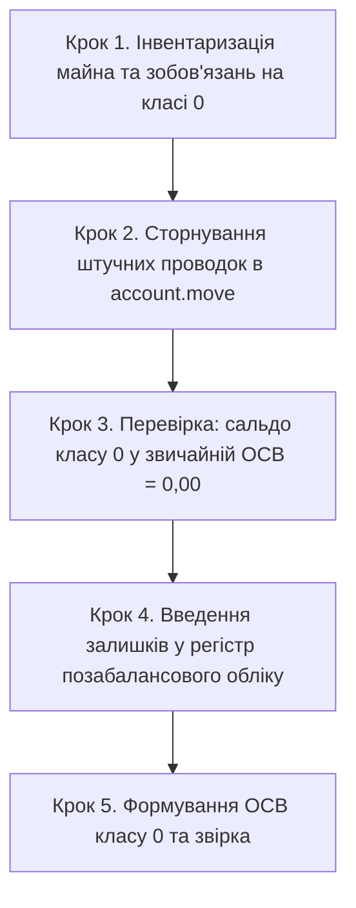

# HOWTO: Перехід на простий позабалансовий облік (клас 0) та сторнування штучних залишків

← [Назад до інструкцій](README.md) · [Бухгалтерський облік](accounting.md) · [Опис домену](../core_accounting.md)

> Ця інструкція призначена для головних бухгалтерів та обліковців комерційних і бюджетних установ,
> які переходять зі старої схеми «штучного подвійного запису» (пари `Дт 01 / Кт 09` або проведення через технічні рахунки `00`)
> на офіційний регістр позабалансового обліку `l10n_ua.offbalance.move` за простою (односторонньою) системою.

---

## 1. Чому потрібен перехід: законодавча та технічна база

Згідно з **Інструкцією про застосування Плану рахунків бухгалтерського обліку** (наказ Мінфіну України від 30.11.1999 № 291)
та **Порядком застосування Плану рахунків у державному секторі** (наказ Мінфіну від 29.12.2015 № 1219):

* Облік на рахунках класу 0 ведеться **за простою системою** — запис робиться лише за дебетом (надходження) або лише за кредитом (вибуття), **без кореспонденції з іншими рахунками**.
* Оскільки ядро Odoo вимагає балансу кожної проводки (`account.move._check_balanced`), раніше бухгалтери були вимушені робити штучні подвійні записи на кшталт `Дт 01 / Кт 09`.

### Недоліки старої схеми
1. **Викривлення Головної книги та ОСВ**: рахунки класу 0 штучно потрапляли в загальний дебетовий і кредитовий оборот підприємства, хоча вони не є активами чи капіталом підприємства.
2. **Ризик помилок у Балансі (Форма № 1)**: залишкові суми штучних кореспондентів могли випадково потрапляти до рядків звітності.
3. **Відсутність повноцінного кількісного обліку**: стандартні балансові рядки складно пов'язувати з кількістю орендованих площ, одиниць обладнання чи бланків.

У модулі `l10n_ua_account_base` реалізовано незалежний регістр позабалансового обліку:
* Документи: `l10n_ua.offbalance.move` (за простою системою).
* Рядки: `l10n_ua.offbalance.move.line` (із фіксацією кількості, контрагента, напряму Дт/Кт).
* Окрема звітність: **ОСВ по класу 0** (`l10n_ua.offbalance.osv`) із можливістю друку PDF у ландшафтній орієнтації.
* Бюджетна звітність: **Меморіальний ордер № 16 (МО-16)** за наказом Мінфіну № 755.

---

## 2. Покроковий процес міграції

### Крок 1. Інвентаризація майна та зобов'язань на класі 0
Перед переходом складіть відомість фактичного майна, що перебуває на позабалансовому обліку на обрану дату (наприклад, `31.12.2025` або кінець звітного кварталу):
* **Рахунок 01**: орендовані приміщення, автомобілі, обладнання (найменування, площа/кількість, договірна вартість, орендодавець).
* **Рахунок 02**: активи на відповідальному зберіганні або переробці (номенклатура, кількість, вартість, поклажодавець).
* **Рахунок 08**: бланки суворого обліку (трудові книжки, атестати, дипломи — кількість штук, за наявності — номінальна вартість).

### Крок 2. Сторнування штучних проводок в `account.move`
Щоб очистити балансові регістри від штучних проводок, скористайтеся стандартним механізмом реверсу (сторнування) Odoo:

1. Перейдіть: **Бухоблік → Бухгалтерія → Транзакції / Операції → Журнальні записи** (*Accounting → Accounting → Transactions → Journal Entries*).
2. Знайдіть і відкрийте проведений журнальний запис старої схеми (наприклад, операцію з рядками `Дт 01 100 000 / Кт 09 100 000`).
3. На панелі дій натисніть штатну кнопку **«Сторнувати запис» (`Reverse Entry`)**.
4. У діалоговому вікні реверсу вкажіть:
   * **Дата реверсу**: дата переходу (наприклад, `31.12.2025`).
   * **Журнал**: журнал оригінальної операції (або «Операції вручну»).
5. Натисніть **«Повернення» (`Reverse`)**.  
   *(Для журнальних записів типу `entry` при даті реверсу `<=` поточної дати зворотний запис `Кт 01 / Дт 09` створюється та **проводиться автоматично** (`auto_post = 'no'`), закриваючи штучні залишки до `0,00` і зберігаючи зв'язок з оригіналом через `reversed_entry_id`; якщо вказано майбутню дату, документ планується до автопроведення на обраний день.)*

### Крок 3. Перевірка: сальдо класу 0 у звичайній ОСВ = 0,00
Сформуйте стандартну **Оборотно-сальдову відомість** (**Бухоблік → Звітність → Бухгалтерські звіти → Оборотно-сальдова відомість**). Переконайтеся, що кінцеве сальдо за всіма субрахунками класу 0 дорівнює **0,00**.

> [!IMPORTANT]
> Перехід до наступного кроку слід здійснювати лише після того, як сальдо за класом 0 у стандартній ОСВ повністю обнулено, щоб уникнути задвоєння залишків.

### Крок 4. Введення залишків у регістр позабалансового обліку
Тепер внесіть реальні об'єкти до нового одностороннього регістру:

1. Перейдіть: **Бухоблік → Бухгалтерія → Позабалансовий облік (клас 0) → Записи позабалансового обліку** (*Accounting → Accounting → Off-Balance (Class 0) → Off-Balance Entries*).
2. Натисніть **Створити**.
3. Заповніть заголовок:
   * **Дата**: `31.12.2025` (щоб сума потрапила у *Початковий залишок* на `01.01.2026`), або дату початку роботи в регістрі (`01.01.2026`, якщо введення відображається як надходження першого місяця).
   * **Документ-підстава**: «Введення залишків позабалансового обліку станом на 01.01.2026».
4. У вкладці **Рядки** додайте позиції:
   * **Рахунок**: `01 Орендовані необоротні активи`.
   * **Напрям**: `Надходження (Дебет)`.
   * **Контрагент**: оберіть орендодавця (наприклад, `ПрАТ "Орендодавець Плюс"`).
   * **Об'єкт обліку**: найменування майна (наприклад, `Оренда офісного приміщення 500 кв.м`).
   * **Кількість**: `1.00`.
   * **Сума**: вартість за договором (наприклад, `1 200 000,00`).
5. Повторіть для активів на зберіганні (рах. `02`) та бланків суворого обліку (рах. `08`):
   * Для бланків суворого обліку сума може бути `0,00`, якщо ведеться суто кількісний облік у штуках.
6. Натисніть **Провести**. Документу буде автоматично присвоєно номер вигляду `ПБ/2026/00001`.

### Крок 5. Формування ОСВ класу 0 та звірка
Після введення документів перевірте результат у спеціалізованому звіті:

1. Відкрийте звіт: **Бухоблік → Звітність → Бухгалтерські звіти → ОСВ по класу 0**.
2. Натисніть **Створити**.
3. Вкажіть період (наприклад, `01.01.2026 – 31.01.2026`).
4. За потреби встановіть позначку **За контрагентами**, щоб побачити деталізацію майна за власниками / орендодавцями.
5. Натисніть **Розрахувати**.
6. Перевірте початкові залишки, обороти надходження (Дт) та вибуття (Кт), а також кінцевий залишок (суму та кількість).
7. Натисніть кнопку **Друк** (або через меню «Друк» угорі) — сформується офіційна друкована форма PDF в альбомній орієнтації (А4 Landscape).

---

## 3. Звітність для бюджетних установ: Меморіальний ордер № 16 (МО-16)

Для розпорядників бюджетних коштів формування МО-16 здійснюється автоматично:
1. Перейдіть: **Бухоблік → Налаштування → Бюджетний облік (UA) → Меморіальні ордери 1-17** (в англійському інтерфейсі: **Accounting → Configuration → Бюджетний облік (UA) → Меморіальні ордери 1-17**).
2. Оберіть вид: **МО-16 Позабалансовий облік**.
3. Вкажіть період та натисніть **Друкувати**.

### Структура звіту МО-16
Для забезпечення суворої відповідності обліковим регістрам друкована форма МО-16 складається з чотирьох блоків:
1. **Типова форма № 16-авт** (Накопичувальна відомість позабалансового обліку):
   * відображає хронологічні операції виключно з нового регістру `l10n_ua.offbalance.move.line`, підсумки до кредиту та дебету субрахунків і рядок «Сума оборотів за меморіальним ордером».
2. **Таблиця «Залишки на початок і кінець періоду (у розрізі позабалансових субрахунків)»**:
   * розгортає початкові залишки, надходження (Дт), вибуття (Кт) та кінцеві залишки за сумою й кількістю;
   * рядок **«РАЗОМ за відомістю (збігається із загальним підсумком ОСВ класу 0)»** **строго узгоджується з ОСВ по класу 0**.
3. **Автоматичні діагностичні попередження** у шапці:
   * сигналізують про неперенесені залишки минулих періодів, ризик подвійного обліку (якщо старі проводки не сторновані) або паралельні/неперенесені операції поточного періоду в `account.move.line`.
4. **«Додаток: Довідково — Історичні проводки подвійного запису (`account.move.line`)»**:
   * друкується на окремому аркуші лише за наявності проводок класу 0 у `account.move.line` за обраний період (технічні балансуючі субрахунки `09` у парних проводках виключено);
   * наводиться виключно довідково й не входить до оборотів форми № 16-авт та ОСВ класу 0.

> [!TIP]
> **Рекомендації для чистоти звітності у перехідний період**:
> * Проводьте операцію сторнування/закриття старої схеми датою кінця попереднього звітного періоду (наприклад, `31.12.2025`), а введення початкових залишків у новий регістр — цією ж перехідною датою (або початком нового періоду `01.01.2026`, якщо вони мають відображатися як надходження першого місяця).
> * У такому разі МО-16 за новий період міститиме лише чисті записи позабалансового регістру, без додатків і діагностичних попереджень, а обороти та залишки повністю узгоджуватимуться з ОСВ по класу 0.

---

## 4. Подальша щоденна робота

Після завершення міграції всі нові позабалансові операції реєструються виключно через документи позабалансового обліку:

| Господарська операція | Рахунок | Напрям | Документ-підстава |
|-----------------------|---------|--------|-------------------|
| Отримання майна в оренду | `01` | Надходження (Дебет) | Акт приймання-передачі в оренду |
| Повернення орендованого майна | `01` | Вибуття (Кредит) | Акт повернення орендованого майна |
| Прийняття ТМЦ на відп. зберігання | `02` | Надходження (Дебет) | Акт МХ-1 |
| Повернення ТМЦ зі зберігання | `02` | Вибуття (Кредит) | Акт МХ-3 |
| Отримання бланків суворого обліку | `08` | Надходження (Дебет) | Видаткова накладна |
| Списання використаних бланків | `08` | Вибуття (Кредит) | Акт списання бланків суворої звітності |

Завдяки відокремленню простого позабалансового обліку баланс підприємства залишається бездоганно точним, а аудит орендованого майна та збережених цінностей здійснюється прозоро в розрізі партнерів та кількостей.
